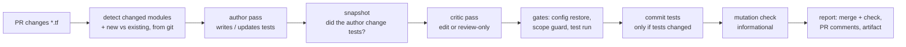

# SOLUTION — Terraform Test Agent

On every pull request that changes Terraform, an agent writes or updates `terraform test`
tests for the changed modules. It runs them, reports what a reviewer should know, and leaves
the results in the pull request. It never changes infrastructure code. Decisions about the
infrastructure stay with people.

**The principle behind every decision: the LLM judges, deterministic code verifies.** The agent
decides what to test and what is risky. Plain TypeScript in the workflow then checks the
results:
- it re-runs the tests itself;
- it enforces which files may change;
- it checks that the agent reported on every changed module;
- it reads the facts from git instead of trusting the agent's description of them.

| Where to look | What it shows |
| --- | --- |
| [PR #5](https://github.com/szuler/cloudfide-tf-platform-base/pull/5) (open, kept as a demo) and its [summary comment](https://github.com/szuler/cloudfide-tf-platform-base/pull/5#issuecomment-6249965170) | **The example PR.** Seven runs on one change, before and after the agent was improved (see [Example run](#example-run)). |
| [PR #11](https://github.com/szuler/cloudfide-tf-platform-base/pull/11) (open, kept as a demo) | Backfill of `function-app`: mocking `data "external"`, plus a wrong finding that was fixed in the skills. |
| [PR #3](https://github.com/szuler/cloudfide-tf-platform-base/pull/3) (merged) | The simplest first run: `databricks-workspace`. |
| [PR #13](https://github.com/szuler/cloudfide-tf-platform-base/pull/13) (merged) | Backfill of `private-endpoint`, after the skill fixes from PR #12. |
| PRs #2, #4, #6–#10, #12 (merged) | Changes to the agent itself, each one prompted by something a demo run showed. |

## How it works



1. **Detect** (`detect-changed-modules.ts`): finds which modules or stacks the PR changed, and
   whether each one existed at the base commit.
2. **Author pass** (`claude-code-action`, agent `terraform-test-engineer`): classifies the change
   as behaviour-affecting or cosmetic. Then it writes tests, runs them, decides on failures
   whether the test or the code is at fault, and reviews the change for risk. It writes a JSON
   report.
3. **Snapshot** (`test-snapshot.ts`): records which test files the author changed. If it
   changed none, the critic runs **review-only**.
4. **Critic pass**: a separate, fresh-context run of the same agent with the `tf-review-tests`
   skill. It tries to reject every assertion. In edit mode it fixes tests; in review-only mode
   it only suggests, and any edit it makes anyway is undone.
5. **Gates**:
   - a check that the agent configuration it ran with is the base branch's (*config restore*);
   - the **scope guard**: only test files may change;
   - the **authoritative test run** (`run-tests.ts`).
6. **Commit**: test files only, and only after a successful author pass, under its own git
   identity, with `[skip ci]`.
7. **Mutation check** (`mutation-check.ts`): plants small bugs in copies of each module and
   reports which ones the final tests miss.
8. **Report** (`merge-report.ts`, `pr-comments.ts`):
   - merges the agent's report with the authoritative results and fails the job if a report or
     a decision is missing;
   - posts one **permanent summary comment** (one row per run, never hidden) and one **comment
     per run** (older ones hidden as outdated);
   - uploads the full report as an artifact.
9. **Metrics** (`run-metrics.ts`): one `metrics.json` per run in the artifact, plus a table in
   the job summary.
   - **cost:** USD and tokens per pass, and the share of input tokens served from the cache;
   - **performance:** time, turns, and why each pass ended (e.g. `api_error`);
   - **quality signals:** tests, mutation headline score, critic verdicts, labels git had to
     correct, findings by severity and confidence, blocked tool calls.

   It's informational, built only from data the run already has.

## Main decisions — and what they cost

**Runtime: `anthropics/claude-code-action`, pinned by commit SHA, authenticated with an
`ANTHROPIC_API_KEY` that has a spend limit.**
- *Why:* Claude Code is the agent environment with custom agents and skills, and the action
  runs it unattended on GitHub. A subscription login in CI would break Anthropic's consumer
  terms.
- *Gave up:*
  - `gh-aw` and a native GitHub Copilot run (`.github/copilot-instructions.md` is only a thin
    adapter to `AGENTS.md`, not wired up or tested);
  - workload identity federation (it needs an Anthropic organisation).

**Split between the LLM and deterministic code.**
- *Why:* the model's report of its own work isn't evidence. The real case: early on, a run came
  back **green while every Write and Bash call had been blocked**. The action input I'd used,
  `additional_permissions`, controls GitHub token scopes, not tool permissions. The agent wrote
  nothing, and the comment said "nothing to do". Since then:
  - the workflow re-runs the tests itself;
  - it fails the job when the report or a module's decision is missing;
  - it reports blocked tool calls as warnings;
  - it overrides the agent's labels with git facts (new vs existing module, "agent reported
    'created', git shows no test changes").
- *Cost:* about 2,200 lines of TypeScript plus 1,150 lines of tests (`.github/scripts`, 100 unit
  tests, zero runtime dependencies, Node 24 runs TypeScript natively). That's more code to
  maintain than a prompt-only solution.

**Least privilege and untrusted PR content.**
- Event and secrets:
  - the trigger is `pull_request` (not `pull_request_target`), and PRs from forks are skipped
    because they would need the secret;
  - the job's token has `contents: write` and `pull-requests: write` only.
- What the agent may do:
  - tools are limited to `Read, Write, Edit, Glob, Grep, Bash(terraform:*)` and read-only `git`,
    with web access denied;
  - the prompt treats all PR content as data;
  - the scope guard (`git status --porcelain`, which also sees untracked files) fails the run if
    anything except a test file changed.
- Agent configuration:
  - `claude-code-action` reloads `.claude/` and `CLAUDE.md` from the base branch before each
    pass, so **a PR cannot change the agent that reviews it**;
  - a workflow step checks this, then puts the PR's own copy back so the scope guard sees a
    clean tree.
- Comments:
  - only the bot's own comments are read, so nobody can plant a fake summary;
  - comment bodies are read from files, never interpolated into a script.
- Actions are pinned by commit SHA.
- **The agent's full transcript is off by default.**
  - `show_full_output` writes every message and tool result to the Actions log. It was turned
    on (`b129b90`) while I debugged the blocked tool calls on the first PR, because without the
    transcript you couldn't see what the agent was trying to do.
  - The action's own documentation says to use it "only for debugging in non-sensitive
    environments", since tool results can contain sensitive data and logs are public in a public
    repository. It's now off unless the repository variable `TF_AGENT_DEBUG` is `true`.
  - What a reviewer needs is still there without it: the PR comments, the job summary, and the
    full JSON report as a run artifact. Blocked tool calls are counted from the action's
    execution file, not from the transcript.
- *Cost:* the agent can't fetch documentation, so claims about Azure behaviour come from model
  memory (see [Limitations](#limitations)).

**An independent critic, with review-only mode.**
- *Why:* an author defends its own tests. In one early trial, the author kept a tautology (an
  assertion that restates a hard-coded SKU), and only a fresh-context critic rejected it.
- Review-only mode exists because on PR #5 a description-only push still produced a test commit:
  the critic kept "improving" a suite nobody had changed. Tests should change because the code
  changed.
- The critic is a quality layer, not a safety gate: if it fails, the PR isn't blocked.
- *Cost:* a second model pass, about 40% of each run's cost.

**Mutation check as evidence for the reviewer, not a gate.**
- *Why:* "the tests pass" says nothing about whether they would catch a bug. On PR #5 the first
  suite passed 5/5, yet it only **counted** log blocks. A bug that corrupted every category name
  still passed. The mutation check made that visible and measurable (1/4 → 3/4).
- What the headline score judges is decided by a fact from git. This was the simpler of the two
  designs I considered:
  - if the module got its first tests in this PR, every mutant judges the agent's suite;
  - otherwise the headline is mutants on the lines the PR changed.
- *Gave up, for now:* the more thorough design. It runs each mutant against both the old and the
  new tests, which would also show tests that got weaker. It's proposed as a later improvement
  (see [Production](#what-would-change-for-a-production-version)). Mutations are plain regexes,
  one per type and module: crude but transparent.

**PR comments that keep history.**
- A single comment overwritten on every run would lose "the agent added these tests" as soon as
  a later run had nothing new.
- So there's a permanent summary comment whose rows come from the agent's commits in git, and
  are kept as state inside the comment, so a force-push can't erase them. Next to it, a full
  comment per run.

## How to run it

**Prerequisites**
- A GitHub repository with Actions enabled. The workflow is in `.github/workflows/tf-test-agent.yml`.
- A repository secret `ANTHROPIC_API_KEY`: an Anthropic Console API key, ideally with a spend
  limit. When a limit is hit, the run fails red with the API error and posts "the agent did not
  produce a report". That happened twice during this project, and the job never went falsely
  green.
- No Azure subscription or credentials. Tests use `mock_provider` and `command = plan`.
- The agent configuration (`.claude/`, `CLAUDE.md`, `AGENTS.md`) must be on the base branch. A
  change to it takes effect only after merge.

**On a pull request:** open or update a PR that changes `modules/**/*.tf` or `stacks/**/*.tf`.
One run per PR (a new push cancels the one in progress) takes about 5–7 minutes. The agent's
own commit carries `[skip ci]`, so it doesn't start another run.

**Auditing an existing test suite** (`.github/workflows/tf-test-audit.yml`):
```sh
gh workflow run tf-test-audit.yml -f module=modules/storage-account
```
The PR workflow only reviews modules a PR changes, so the original suites would never be looked
at again. The audit fills that gap on demand:
1. The agent builds the module's coverage matrix (`tf-coverage-matrix`), reviews every existing
   test as a critic, writes tests for the gaps, and reviews the whole module for risk.
2. **Nothing is committed and no PR is opened.** The token is read-only (`contents: read`).
3. The workflow runs the scope guard and the tests on the proposals. It measures the **mutation
   score before and after**, so a proposal that weakens the suite shows up as a regression.
4. It publishes `proposal.patch` in the `tf-test-audit` artifact, with a summary in the job
   summary.
5. A person applies the patch on a branch (`git apply proposal.patch`) and opens a PR if they
   agree. The PR workflow then runs on it as usual.

**Debugging a run:** `gh variable set TF_AGENT_DEBUG --body true` adds the author's full
transcript to the Actions log. `gh variable delete TF_AGENT_DEBUG` turns it off again. Keep it
off in a public repository except while debugging.

**Locally**
```sh
cd .github/scripts && npm ci && npm test        # 100 unit tests, plus `npm run typecheck`
cd modules/<name> && terraform init -backend=false && terraform test
# mutation-check a module's suite (TERRAFORM_BIN is honoured):
node --experimental-strip-types .github/scripts/mutation-check.ts modules/<name>
# run the agent itself (Claude Code CLI, from the repo root):
claude -p "Write tests for modules/<name>" --agent terraform-test-engineer
```

## Where the agent and skills are defined, and how they are used

| File | Role |
| --- | --- |
| `AGENTS.md` | The contract every agent reads: hard boundaries, test conventions, reporting. The single source of truth (Copilot reads it too). |
| `.claude/agents/terraform-test-engineer.md` | The custom agent: process, boundaries, report schema. |
| `.claude/skills/tf-write-tests` | How to write tests in this repo's style: values, not just counts; mock `data "external"`; no tautologies; a guard protects the safe direction only. |
| `.claude/skills/tf-diagnose-test-failures` | When a test fails, is the test wrong or the code? Never "fix" code to pass. |
| `.claude/skills/tf-risk-review` | Findings with location, impact and confidence (`fact` / `likely` / `hypothesis`); claims about Azure from memory are at most `likely`. |
| `.claude/skills/tf-review-tests` | The critic's checklist: try to reject each assertion; edit or review-only mode. |
| `.claude/skills/tf-coverage-matrix` | Backfill: what behaviour a module has vs what its tests cover. **Not wired into the CI prompt.** Only the agent file mentions it, and neither CI backfill (PRs #11, #13) reported using it. Wiring it in is listed under [Limitations](#limitations). |
| `.github/scripts/` | The deterministic steps. Pure logic sits in `lib/` with colocated `*.test.ts`. |

**At run time:**
- The workflow's prompt tells the author to read the agent file and `AGENTS.md`, then to "read
  `.claude/skills/<skill>/SKILL.md` and follow its instructions" at each step. Unattended runs
  have no slash-command skill invocation, so the skills are loaded as files.
- The prompt also passes the facts from git: the module list, new vs existing, and the exact
  diff command.
- The critic gets the `tf-review-tests` skill and the mode the workflow decided.
- The agent writes `.github/tf-test-agent-report.json`, which is git-ignored. The workflow
  merges it with the authoritative results.

## Example run

**[PR #5](https://github.com/szuler/cloudfide-tf-platform-base/pull/5)**: `data-factory`, two
hard-coded `enabled_log` blocks replaced by a configurable `diagnostic_log_categories`
(`set(string)`, default `["ActivityRuns", "PipelineRuns"]`, validation rejecting an empty set).
The module had no tests. Its [summary comment](https://github.com/szuler/cloudfide-tf-platform-base/pull/5#issuecomment-6249965170)
shows all seven runs:

| Run | Trigger | Agent's decision and skills | Tests | Mutations | Notes |
| --- | --- | --- | --- | --- | --- |
| 1 | the change | **created** the suite (`tf-write-tests`, `tf-diagnose-test-failures`, `tf-risk-review`) | 5/5 | 1/4 (checked locally, before the CI step existed) | Tests only counted blocks; the critic added a tautology |
| 2 | after the skills required value assertions | **updated**: value assertions for categories (author), `url` assertion (critic) | 5/5 | **3/4** | Finding now `likely` + "from memory, verify" |
| 3 | a description-only push | author **skipped**, critic still added 2 assertions | 6/6 | 3/4 | Led to review-only mode |
| 4–7 | description-only pushes | skipped; critic review-only; **no commit** | 6/6 | 3/4 | Older run comments hidden; the summary rows stay |

- **Findings:** `info / likely`. The validation doesn't check category names, so a typo fails
  only at apply. The list of valid categories is marked "from memory, verify against the azurerm
  docs".
- **The surviving mutant:** nothing pins the default `public_network_enabled = true`. That's
  flagged for a person to decide: pinning it would cement public access as the default.

**Other cases:**
- **[PR #11](https://github.com/szuler/cloudfide-tf-platform-base/pull/11)** (`function-app`, open):
  - 12 tests, with `mock_provider "external"` + `override_data`, so `build-info.sh` never runs.
  - Run 1 claimed "Storage Blob Data **Contributor** has no delete". That's false according to
    the [Microsoft Learn built-in roles page](https://learn.microsoft.com/en-us/azure/role-based-access-control/built-in-roles/storage).
    Run 1 also kept "security guards" that pinned the over-broad Owner role and the public
    default.
  - After PR #12 changed the skills, run 2 states the role correctly, removes both "guards", and
    also reports the `data "external"` script.
- **[PR #3](https://github.com/szuler/cloudfide-tf-platform-base/pull/3)** (`databricks-workspace`, merged):
  7 tests, one strengthened by the critic, 2 findings.
- **[PR #13](https://github.com/szuler/cloudfide-tf-platform-base/pull/13)** (`private-endpoint`, merged):
  - 7 tests, both private-DNS branches included; the critic added a value assertion on the zone
    ID.
  - It also shows the limits. The mutation check found **no applicable mutant**: the `dynamic`
    iterator is used inside a list, `[x.value]`, which the regex doesn't match. It says "not
    checked" rather than claiming a score.
  - The critic kept one tautology (`is_manual_connection == false`).
  - The one finding states Azure's NIC naming rules from memory but labels them `fact`.

**Cost and time:** author + critic come to **$0.52–0.63 per run** on PRs #3, #5 and #13, and
**$0.75–0.77** on PR #11 (a bigger module, a 12-run suite). Each pass takes about 2 minutes, the
whole job 4.7–7 minutes. Figures are from `total_cost_usd` in the runs' logs.

## Test coverage: at the start and now

`terraform test` has no built-in coverage metric, so the table shows two things for each module:
- how many test runs it has, at the start (commit `95d7168`) and now;
- its mutation score.

Each mutation score is `mutation-check.ts` run locally across the **whole module**, so the
modules can be compared.

| Module | At the start | Now | Where the tests are | Mutations caught | Survivors (what no test checks) |
| --- | --- | --- | --- | --- | --- |
| `data-factory` | — | 6 runs | open PR [#5](https://github.com/szuler/cloudfide-tf-platform-base/pull/5) | 3/4 | default `public_network_enabled = true` |
| `databricks-workspace` | — | 7 runs | main (via PR [#3](https://github.com/szuler/cloudfide-tf-platform-base/pull/3)) | 2/2 | — |
| `function-app` | — | 11 runs | open PR [#11](https://github.com/szuler/cloudfide-tf-platform-base/pull/11) | 2/2 | — |
| `key-vault` | 2 runs | 2 runs | main (original) | 2/4 | default network action `Deny`; role `principal_id` values (only counted) |
| `log-analytics-workspace` | — | 3 runs | main (added during development, before the PR workflow existed) | not checked | — |
| `network` | 3 runs | 3 runs | main (original) | 1/1 | — |
| `private-endpoint` | — | 7 runs | main (via PR [#13](https://github.com/szuler/cloudfide-tf-platform-base/pull/13)) | not checked | — |
| `storage-account` | 3 runs | 3 runs | main (original) | 4/7 | `shared_access_key_enabled = false`, `https_traffic_only_enabled = true`, a `false` default |
| `stacks/data-platform` | — | — | — | — | not tested |

How to read it:
- **"Not checked" means no mutation pattern applied**, not that the tests are perfect. The
  mutation set is a few regexes, so a small score like 2/2 is a weak signal.
- **The three original suites were never touched by the agent.** It reviews only the modules a
  PR changes. Their survivors are real gaps. For example, nothing would notice if
  `storage-account` re-enabled shared-key access.
- **Existing suites are reviewed by a separate, manual audit run** (see
  [How to run it](#how-to-run-it)). It proposes tests as a patch and measures them by mutation
  score before vs after, without committing anything.

## What the generated tests can and cannot show

The tests run `terraform test` with `command = plan` against mocked providers.

**They can show:**
- defaults and how inputs reach resources (values, not just counts);
- `for_each` / `count` / `dynamic` results for given inputs;
- conditional blocks;
- `validation` rules (via `expect_failures`);
- output logic;
- that a script-backed `data "external"` is wired in, with its result mocked.

**They cannot show:**
- **Anything decided by Azure:** whether a SKU, log category or role name is valid, or what a
  role really grants. A mocked provider accepts any string.
- **"Known after apply" values:** IDs, private IP addresses, generated endpoints.
- **Runtime behaviour:** network reachability, DNS, permissions in effect, policy compliance,
  drift.
- **Whether modules work together:** the stack has no tests.
- **What the real `build-info.sh` returns.**

A green suite means "the planned configuration matches what the tests expect", not "this deploys
and is secure". The mutation check measures how much the suite would notice. It's still plan
level.

## Assumptions

- Plan-level tests with mocked providers are the right PR-time feedback: fast, free, no
  credentials. Apply-level testing belongs to a later stage.
- Modules are independent units, and a PR's changed modules are what matters for review.
- Reviewers read the PR comments, and the agent's job is to inform them, not to gate merges on
  its judgement.
- About $0.5–0.8 per run is acceptable for PR-time review. The API key has a spend limit.
- `claude-sonnet-4-6` is a good enough trade-off between cost and quality for both passes.
- Artifacts, code and comments are in English.

## Limitations

- **Severity and confidence are the model's judgement**, and they vary. The same `ftps_state`
  finding came out `medium` in one run and `high` in the next. A role claim was correct but
  still labelled `fact` despite the skill's rule. The gates check scope, test results, report
  completeness and git facts, not whether a finding is right. A wrong finding is possible, as PR
  #11 shows.
- **Claims about Azure come from memory:** the agent has no web access, by design. The skills
  make it mark them as "verify", and it doesn't always.
- **The review is per module.** On PR #13 the stack calls `private-endpoint` without a private
  DNS zone, so clients would still resolve the public address. That's a real risk, but outside
  the module the agent reviews.
- **The mutation check** has one mutant per type and module, uses regexes over HCL text, and
  has no "weakened test" detection (differential). The regexes miss forms they weren't written
  for. On `private-endpoint` nothing applied, and the check reports "not checked", not a score.
- **The skills grew through fixes, one PR at a time.** A few rules repeat between the author's
  and the critic's skills, and `tf-coverage-matrix` isn't wired into the CI prompt.
  Consolidating them should wait for the golden-PR regression suite (see
  [Production](#what-would-change-for-a-production-version)). Without it, a prompt refactor
  can't be shown to help rather than hurt.
- **The critic doesn't catch every tautology.** On PR #13 it kept an assertion that restates a
  hard-coded, non-security `is_manual_connection = false`.
- **The critic** reviews only the changed modules' tests, and only when the author pass
  succeeded.
- **The audit is manual and runs one module at a time.** It has no critic pass: its independent
  check is the deterministic mutation score before vs after, plus the person who decides whether
  to apply the patch. Running it on a schedule for every module is the obvious next step.
- **Changes to the agent or skills take effect only after merge to the base branch.** That's
  deliberate, but it means a skill change can't be tested on the PR that makes it.
- **Terraform 1.16.6 crashes when an assertion on a diagnostic setting's `enabled_log` fails**
  (`panic: value has marks`). The run is still reported as failed (and the mutation check
  counts it as caught). The test-results row then says "no result parsed", and the
  `tf-diagnose-test-failures` skill explains it to the agent.
- **No required status check.** Branch protection isn't available on a private Free repository,
  so the check is informational until the repository is public.
- **Coverage on main:** 6 of 8 modules have tests. `data-factory` and `function-app` have theirs
  in the open demo PRs #5 and #11, kept open on purpose to show multi-run history. The stack has
  none.

## What would change with many more modules, teams or repositories

- **More modules per PR:** run the passes per module, as a matrix job, so one large PR doesn't
  run into `max-turns` and failures stay isolated. Cache providers, and cap the cost per run
  (modules × about $0.6) with a clear "too many modules, run per module" message.
- **More teams:**
  - `CODEOWNERS`, so findings reach the owning team;
  - per-team conventions in each module's own `AGENTS.md` section, while the boundaries stay
    central;
  - a severity policy agreed with security, not left to the model.
- **More than one Terraform repository:** move the agent into its own repository.
  - **One repository owns the agent:** `AGENTS.md`, the agent, the skills, the scripts, and the
    workflow as a **reusable (`workflow_call`) workflow**.
  - **Each Terraform repository is a thin caller:**
    `uses: <org>/tf-test-agent/.github/workflows/tf-test-agent.yml@<tag or SHA>`, plus its own
    secret and path filters.
  - **Versioning:** each caller pins a version and upgrades deliberately, because a skill change
    is a behaviour change.
  - **Security improves.** Today the agent's configuration comes from the PR's base branch, so
    anyone who can merge to main can change how the agent behaves. With a separate repository,
    it comes from a pinned release of the agent repository instead.
    - The workflow would check that release out next to the code.
    - The config-restore check would compare against that release.
  - **Cross-repository metrics:** collect the JSON artifacts centrally for cost, findings and
    mutation-score trends.
- **Other providers (AWS, GCP):**
  - **Mostly provider-agnostic already:** the workflow and the scripts (detect, scope guard, test
    run, report, ledger). So is the approach in the skills.
  - **Azure-specific:** the risk checklist, the test examples, the `mock_provider "azurerm"`
    conventions, and the mutation set (`"TLS1_2"`, `default_action = "Deny"`, …).
  - **The extension:**
    - read the providers from each module's `required_providers`;
    - load a provider-specific skill pack (e.g. `tf-risk-review-aws`: public S3 ACLs,
      `publicly_accessible`, unencrypted volumes, `0.0.0.0/0` ingress) and a provider-specific
      set of mutations;
    - keep the generic skills shared.
- **Prompt changes need regression tests:** keep a set of "golden" PRs with known expected
  outcomes, such as the PR #5 and PR #11 cases, and re-run them before releasing a skill change.

## What would change for a production version

1. **Make it a required check** with branch protection, and decide which outcomes block a merge.
   Scope guard and test failures should; findings shouldn't.
2. **Workload identity federation** instead of a long-lived API key, plus per-repo budgets and
   alerts.
3. **A differential mutation check** (the more thorough design deferred above): run each mutant
   against the base suite and the PR's suite.
   - "Caught only by the new tests" shows what the PR added.
   - "Caught by the old tests, survives the new ones" is the only deterministic signal that
     tests were weakened.
   - The cost is roughly twice the mutation time.
4. **Ground the agent in the azurerm provider documentation (RAG).** Most wrong or unhedged
   findings came from memory: what a role grants, valid category names, NIC naming rules.
   - **Index the docs for the exact provider version** in `.terraform.lock.hcl`, along with the
     Azure built-in roles reference. A deterministic workflow step fetches them, outside the
     agent.
   - **Give the agent read-only search over that index**: local files or an MCP server with one
     `search_docs` tool. It keeps no network access.
   - **Require a citation** (doc and section) for every claim about provider or Azure behaviour.
   - **Check citations deterministically:** a claim without one is downgraded to `likely`, and a
     cited section must exist in the index.
5. **Make findings more reliable:**
   - a fixed severity scale with examples;
   - each finding split into what is observed (`fact`) and what is explained (`likely`);
   - a post-check that downgrades unverified Azure claims;
   - deterministic scanners (Checkov, tfsec, Conftest) next to the agent, so known misconfigs
     such as `ftps_state = "AllAllowed"` are caught by rules, not by luck.
6. **Review and tighten the tools `claude-code-action` gives the agent.** Today both passes get
   `Read, Write, Edit, Glob, Grep, Bash(terraform:*)` and read-only `git`, with web tools denied.
   That's narrower than the default, but still broad:
   - **Path-scope the file tools.** `Read`, `Write` and `Edit` have no path restriction.
     - The scope guard catches a change **inside the git tree**, but only after the fact.
     - Nothing stops a write **outside** it. The workflow keeps its own state in `/tmp`
       (`changed-targets.json`, `author-test-changes.txt`, a copy of the author's execution
       file), and the critic runs after those files are written. An agent that overwrote them
       could, for example, change which modules the authoritative test run covers.
     - Fixes: restrict `Write`/`Edit` to test paths with path-scoped permission rules; restrict
       `Read` to the repository; keep workflow state where the agent can't write it, or
       recompute it after the agent passes (detect is deterministic and cheap).
   - **Narrow `Bash(terraform:*)`** to the subcommands the skills use (`init`, `validate`, `fmt`,
     `test`) and to module directories. Today it allows any subcommand, `-chdir` to any path,
     `console`, `providers mirror`.
   - **Restrict network egress** on the runner to the Anthropic API, the Terraform registry and
     GitHub, for example with an egress-filtering step. `terraform init` needs the registry; a
     pre-filled provider cache or mirror could remove even that.
   - **Scan the agent's commit for secrets** (e.g. gitleaks) before it's pushed. A
     prompt-injected agent's only way to publish data is a test file, and the scope guard
     allows test files.
   - Each of these needs **verifying against the action's actual permission behaviour**, the
     same way the first permission bug was found: by running it, not by reading the docs.
7. **Telemetry beyond the per-run record.** Each run already writes `metrics.json`. The next
   steps:
   - **Trends without a new service:** a scheduled workflow downloads the runs' artifacts
     through the API and reports, for example weekly:
     - cost per run and per module;
     - mutation scores over time;
     - how often git corrects the agent;
     - failure reasons (API limits, `max-turns`).

     Artifacts expire after 90 days, so the summary should be stored, not just re-derived.
   - **OpenTelemetry from Claude Code:** `CLAUDE_CODE_ENABLE_TELEMETRY=1` with an OTLP exporter.
     - It emits metrics (`claude_code.cost.usage`, `claude_code.token.usage`), events (tool
       decisions and results, API errors, skills activated) and, in beta, traces.
     - The docs cover headless (`-p`) mode. Whether the variables reach the CLI inside
       `claude-code-action` still has to be verified.
     - It needs a collector, a secret for it and an egress exception. Prompt and tool content
       stay unlogged, for the same reason the transcript is off.
   - **Measure quality directly, not only through proxies:**
     - a set of "golden" PRs with known correct outcomes (the PR #5 and PR #11 cases), re-run
       on every skill change;
     - reviewer feedback: 👍/👎 reactions on findings, read through the API, give a precision
       figure for findings that no gate can produce today.
8. **Wider scope:**
   - the critic over all of a changed module's tests;
   - stack-level tests and a cross-module review (the private-DNS case);
   - apply-level tests in a sandbox subscription before release.
9. **Run the same contract on GitHub Copilot as well**, if that's the team's platform, to avoid
   depending on one vendor (the thin adapter is already there, untested).

## How the LLM was controlled and verified

I used Claude Code to build this, in phases, with a decision point between each phase. The rule
was: **a claim counts only once it's been run.**
- Every tooling change went through its own PR (#2, #4, #6–#10, #12) with unit tests.
- Each change was replayed against real data before merge: real PR comments, real git history,
  real run artifacts, and the GitHub markdown API for how comments render.
- Each was then confirmed on a live PR run.

That discipline found the problems this document describes:
- the false-green run;
- a scope guard that couldn't see untracked files;
- the Terraform crash on marked values;
- run numbers like `#2` silently linking to other PRs;
- a confident but wrong claim about Azure roles.

Each one was fixed where it belonged: a gate if it could be checked deterministically, a skill
if it was judgement.
